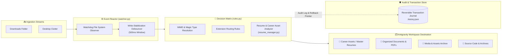

<div align="center">

# 🧹 DigitalHygieneAuto

### Autonomous Desktop Hygiene, Resume Management & Storage Reclamation Daemon
**Python 3.10+ • Watchdog Event-Driven • Reversible SQLite/JSON Journaling • Automated Scheduling**

<p align="center">
  <em>Real-time zero-polling file system sentry, automated Downloads/Desktop triage, and intelligent career asset versioning.</em>
</p>

<!-- Badges -->
<p align="center">
  <a href="https://www.python.org/downloads/"></a>
  <a href="https://pypi.org/project/watchdog/"></a>
  <a href="https://github.com/Anudeep-Adari/DigitalHygieneAuto"></a>
  <a href="https://coderabbit.ai"></a>
  <a href="LICENSE"></a>
</p>

<p align="center">
  
  
  
</p>

---

</div>

## 📌 Architecture & Routing Pipeline



---

## ⚡ Core Engineering Highlights

* **Real-Time Zero-Polling Observer:** Powered by operating system filesystem hooks via `watchdog`, consuming negligible CPU (<0.2%) and idling under 35MB RAM.
* **Write-Completion Debounce:** Waits for browser or installer file locks to fully release before initiating relocation, preventing corrupted partial downloads.
* **Semantic Resume Manager (`resume_manager.py`):** Automatically detects newly generated curriculum vitae, portfolio drafts, and interview prep PDFs, routing them into dedicated structured folders with timestamped revisions.
* **Safe Reversible Journaling:** Records previous absolute paths and SHA-256 hashes into `.history.json`, enabling single-command rollbacks if a file is relocated mistakenly.

---

## 🖥️ Live Terminal Interface Preview

```
================================================================================
  DigitalHygieneAuto v3.0  ─  Autonomous Workspace Sentry
================================================================================
  [STATUS] Active Daemon Running  │  [WATCHING] C:\Users\User\Downloads
  [UPTIME] 14d 08h 12m            │  [EVENTS PROCESSED] 1,482 files
--------------------------------------------------------------------------------
  [23:41:02] FILE_CREATED   -> Senior_DevOps_Resume_2026.pdf
  [23:41:03] CLASSIFIED     -> Career / Master Resumes [RULE_MATCH: ResumeRegex]
  [23:41:03] MOVED          -> G:\Career\Resumes\Senior_DevOps_Resume_2026.pdf
  [23:41:03] JOURNAL_ENTRY  -> Recorded transaction #1483 (Reversible: YES)
--------------------------------------------------------------------------------
```

---

## 🚀 Quickstart & Daemon Setup

### 1. Installation

```bash
# Clone the repository
git clone https://github.com/Anudeep-Adari/DigitalHygieneAuto.git
cd DigitalHygieneAuto

# Install Python requirements
pip install -r requirements.txt # watchdog, pyyaml
```

### 2. Configuration (`config.yaml`)

Define your target routing directories and cleanup rules:

```yaml
watch_paths:
  - "C:/Users/%USERNAME%/Downloads"
  - "C:/Users/%USERNAME%/Desktop"

destinations:
  resumes: "G:/Career/Resumes"
  documents: "G:/Documents/Archive"
  installers: "C:/Temp/Installers"

rules:
  delete_empty_folders: true
  auto_resume_versioning: true
  retention_days_temp: 14
```

### 3. Launching Daemon & Background Scheduler

```bash
# Run foreground watcher
python main.py

# Install as Windows Startup Scheduled Task
python scheduler_helper.py --install
```

---

<div align="center">

Crafted with high engineering precision by **[Anudeep Adari](https://github.com/Anudeep-Adari)**  
Continuous AI Code Reviews powered by **CodeRabbit**

</div>
